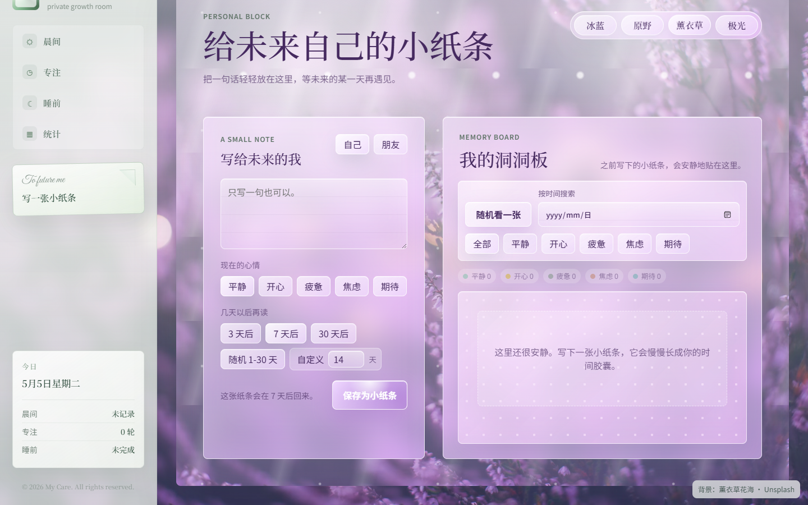

# 🌿 MyCare

**A personal space for routines, goals, and self-care.**

MyCare is a bilingual web app that brings daily routines, personal goals, habits, and reflection together in one place.

We don't have the same amount of time or energy every day. MyCare is designed with that in mind. It helps you decide what to do next, adjust your routines when needed, and keep track of the things that matter to you.

The idea is simple: **make it easier to get started, without making every day about productivity.**

---

## ✨ A Look Inside

*Notes for Your Future Self — an earlier preview in the lavender theme. The interface is still evolving.*

## 🌷 Features

**🌤️ Daily Care**

Create morning and bedtime routines that fit your day. On days when you're running low on energy, switch to a simpler version instead of skipping the routine entirely.

**🎯 Focus & Goals**

Break down personal goals, organize them by category and deadline, and use focus timers with breaks. You can also leave a short reflection when you finish a goal.

**🌱 Habit Garden**

Build habits and track them over time. Each habit can have a low-energy alternative, so you can stay connected to your routine even when your day doesn't go as planned.

**💌 Notes for Your Future Self**

A private place to leave yourself notes, record your mood, or write down something you want to remember.

**📊 Personal Insights**

Look back at your routines, focus sessions, habits, and goals through simple charts. See how things have been going without having to track everything manually.

**🏡 Family Space**

Set goals together with family members and share progress. You can also choose which personal statistics to share, while keeping your private notes and other personal records separate.

**🍃 Health Data**

Import health records from CSV, JSON, or Apple Health XML files to explore trends locally. Direct wearable synchronization is not available yet.

**🎨 Make It Yours**

Switch between English and Chinese, choose a visual theme, customize categories, and edit your morning quotes.

---

## 💡 Design Decisions

I built MyCare around a few problems I wanted the app to handle well.

### 01. Making it easier to start

Sometimes planning is easy, but actually starting is not.

Rather than putting everything in front of the user at once, MyCare focuses on making the next action clear. Low-energy options also make it possible to scale down a routine instead of abandoning it.

### 02. Keeping personal and shared spaces separate

Family members may want to work toward common goals, but that doesn't mean they should have access to each other's private information.

MyCare keeps shared goals separate from personal records. Even summary statistics are optional to share, so users can decide how much of their progress others see.

### 03. Giving users control over their data

A personal app shouldn't require an account just to get started.

MyCare saves personal changes locally first. Cloud synchronization is available for users who want access across devices, but it isn't required for everyday use.

I also wanted users to have a way to recover their information, which led to JSON backups and cloud version history.

These decisions have influenced both the interface and the underlying architecture as the project has grown.

---

## 🛠️ Under the Hood

**Tech Stack:** `HTML` · `CSS` · `JavaScript` · `Supabase Auth` · `PostgreSQL`

MyCare is independently designed and developed, from the interface and interaction flows to data handling, testing, and ongoing improvements.

Some of the more interesting technical work includes:

- **Local-first storage:** Personal changes are saved on the device before optional cloud synchronization.
- **Cross-device synchronization:** Revision checks detect outdated writes, while queued saves preserve edits made during an ongoing upload.
- **Backup and recovery:** Portable JSON backups and cloud version history make it possible to restore previous personal states.
- **Privacy-aware family sharing:** Shared goals and opt-in statistics are managed separately from private personal data.
- **Responsive, bilingual UI:** The interface supports desktop and mobile screens, with English and Chinese language options.

---

## 🚧 Project Status

MyCare is a personal project under active development. I'm continuing to improve the experience, test different use cases, and refine existing features.

A few things worth knowing:

- Imported health records stay on the device and are not included in cloud synchronization.
- Direct synchronization with wearable devices is not supported yet.
- MyCare is intended for personal organization and reflection, not medical use.

**Source Code**

This repository is a public portfolio showcase with product documentation and interface previews. The application source code is maintained in a separate private repository.

No open-source license is granted for the MyCare application through this repository. Third-party materials retain their respective rights.

---

## 🌿 中文介绍

**一个用来安排日常、培养习惯，也好好照顾自己的小空间。**

MyCare 是一款支持中英文的个人成长与自我照顾应用，将日常流程、目标管理、习惯养成和个人记录整合在一起。

我们并不是每天都有一样的时间和精力。有时候计划得很好，却迟迟无法开始；有时候明明想坚持，却因为状态不好而打乱节奏。

MyCare 希望让这些事情变得简单一点：明确下一步要做什么，在精力不足时适当调整，也能慢慢看见自己的变化。

**不必每天都追求高效率，也可以有自己的成长节奏。**

---

## 🌷 主要功能

**🌤️ 日常照顾**

建立适合自己的晨间和睡前流程。状态不好时，可以切换到更简单的低精力版本，不必因为完不成整套流程就全部放弃。

**🎯 专注与目标**

按照类别和截止日期整理目标，使用专注计时与休息功能，也可以在完成目标后记录自己的感受和收获。

**🌱 习惯花园**

记录想要培养的习惯，看看自己一路以来的变化。每个习惯都可以设置低精力替代方案，让习惯不必因为偶尔状态不好而中断。

**💌 写给未来自己的小纸条**

一个私密的记录空间。可以写下当下的心情、想记住的小事，或是留给未来自己的话。

**📊 个人统计**

用简单的图表回顾日常流程、专注记录、习惯和目标完成情况，更直观地了解自己的生活节奏。

**🏡 家庭空间**

和家人一起设立目标、分享进展。也可以自主选择是否公开部分个人统计数据，私人笔记和其他个人记录不会因此变成共享内容。

**🍃 健康数据**

支持通过 CSV、JSON 和 Apple Health XML 文件手动导入健康记录，在本地查看相关趋势。目前暂不支持穿戴设备直接同步。

**🎨 个性化设置**

支持中英文切换、不同的视觉主题、自定义分类，以及编辑属于自己的晨间语录。

---

## 💡 一些设计上的思考

MyCare 的很多功能，来自我在设计过程中一直想解决的几个问题。

### 01. 怎样让开始一件事变得容易？

有时候，我们并不缺少计划，只是很难真正开始。

所以 MyCare 尽量让用户把注意力放在眼前的一步，而不是一次面对所有待办事项。

我也加入了低精力模式和替代方案。比起要求用户每天完成相同的内容，我更希望日常流程能够随着个人状态调整。

### 02. 一起成长，也需要保留私人空间

在设计家庭功能时，我不想简单地把个人数据开放给家庭成员。

共同目标可以共享，但个人笔记、情绪记录和其他私密内容应该有明确的边界。

因此，MyCare 将家庭共享与个人数据分开管理。即使是统计摘要，也由用户自己决定是否分享。

### 03. 个人数据应该掌握在用户自己手里

我希望 MyCare 在没有账号的情况下也能正常使用。

因此，应用采用本地优先的保存方式。用户可以选择是否登录和启用云同步，而不是一开始就被要求注册。

同时，我也加入了 JSON 备份和云端历史版本恢复功能，让用户在需要时能够找回之前的数据。

这些想法并不只是界面上的选择，也影响了后续的数据结构和技术实现。

---

## 🛠️ 技术实现

**技术栈：** `HTML` · `CSS` · `JavaScript` · `Supabase Auth` · `PostgreSQL`

MyCare 由我独立负责产品设计、功能开发、测试与持续迭代，包括界面交互和底层数据管理。

目前比较有代表性的技术实现包括：

- **本地优先存储：** 个人数据变更优先保存在设备上，云同步为可选功能。
- **跨设备同步：** 通过版本检查识别过期写入，并利用保存队列保留上传期间发生的新修改，降低数据被覆盖或丢失的风险。
- **备份与恢复：** 支持 JSON 数据备份，以及通过云端历史版本恢复之前的个人数据。
- **家庭共享与隐私边界：** 使用独立的数据结构管理共享目标和可选统计摘要，避免直接暴露私人记录。
- **响应式双语界面：** 适配桌面端与移动端，支持中英文切换和个性化主题。

---

## 🚧 项目状态

MyCare 是我正在持续开发和完善的独立项目。目前主要围绕已有功能的使用体验、不同场景下的测试以及数据可靠性进行优化。

**当前限制：**

- 手动导入的健康数据仅保存在本地，不参与跨设备云同步。
- 暂不支持穿戴设备 API 的直接数据同步。
- MyCare 用于个人生活管理和自我记录，不提供医疗服务。

**关于源代码**

本仓库是公开的作品展示仓库，主要包含项目介绍、功能说明和界面截图。

应用源代码保存在独立的私人仓库中，不在此公开。本仓库不授予 MyCare 应用的开源使用许可，第三方素材的相关权利归各自权利人所有。

---

*MyCare 🌿*  
*A little space for yourself.*
